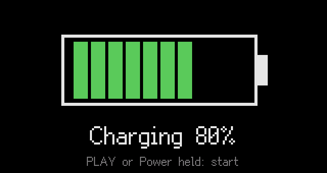
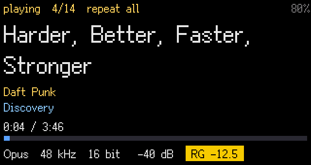
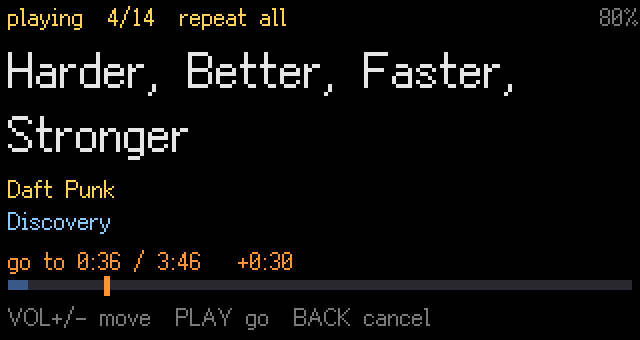
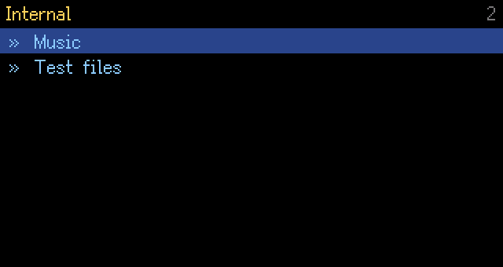
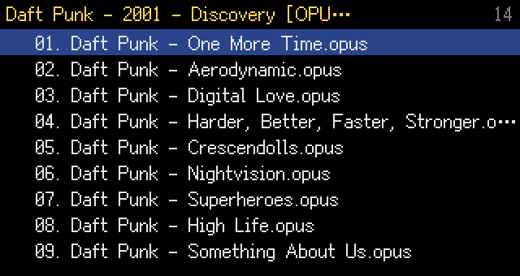
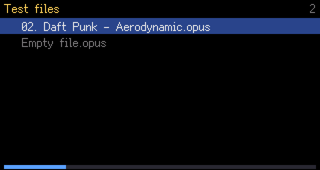
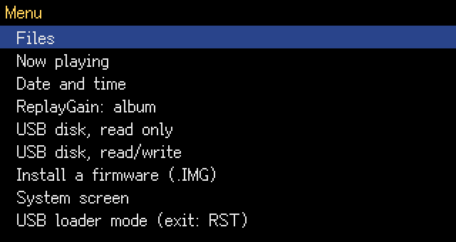
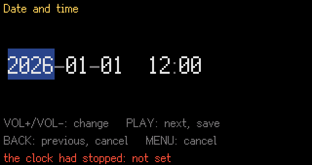
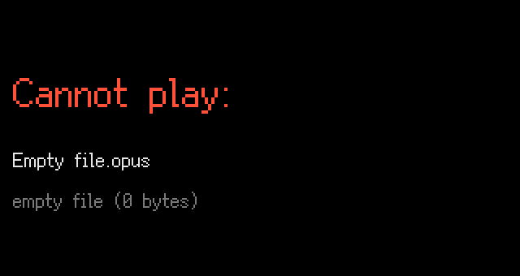

# User manual

This manual is for the ECHO MINI new firmware, version 0.73. It describes what the player shows
and what each key does on each screen. To install the firmware, see "Installing" at the end.

The screenshots come from the emulator of the build tree (`fw/tools/emu_fw.py`), playing Daft
Punk's "Discovery" in Opus. The emulator has no real-time clock, so the clock is missing from the
status line and the date screen says it is not set.

## The keys

| Key | Where |
|---|---|
| **Power** | the side button that switches the player on |
| **VOL+**, **VOL-** | the two volume keys |
| **PLAY** | play / pause |
| **BACK** | previous / back |
| **MENU** | menu |

Each key knows three gestures:

- a **press**: a short press, counted when the key is released;
- a **long press**: PLAY, BACK and MENU held for 0.6 s;
- a **held** VOL+ or VOL-: repeats from 0.45 s, about ten steps a second.

**VOL+ and VOL- together**, the "chord", opens the seek mode on the play screen.

When the screen is off, the first key only switches it on. It does nothing else, so a key
pressed in a pocket does not change the track or the volume.

## Switching on and off

| Action | Result |
|---|---|
| Power, player off | starts the player; it resumes where it was (folder, track, position, volume, play mode) |
| Power, short press | switches the screen off or on; the music goes on |
| Power held 2 s | powers off; the position is saved |

The screen goes off by itself after 30 s without a key.

**With the USB cable**: plugging the cable into a player that is off shows the **charging
screen**:

It has a battery bar and "Charging NN %", or "Charged 100 %" once the charger has
finished. On the charging screen:

- any key switches the screen on again;
- PLAY held, or Power held 1 s, starts the player;
- unplugging the cable powers it off.

Holding Power 2 s while playing with the cable in also leads to the charging screen.

## The play screen

From top to bottom:

1. **The status line**:
   - the state: playing, paused or stopped;
   - the position in the play queue;
   - the play mode, unless it is "in order";
   - the clock;
   - the battery. "CHG" means charging and "USB" means charged, with the cable in. The
     battery turns red under 3.4 V.
2. **The title**, or the file name when the file has no title tag.
3. **The artist and the album**, or the folder when the file has no album tag. They scroll when
   too long.
4. **The time and the bar**.
5. **The format line**:
   - the codec, the sample rate and the bit depth;
   - the volume, as an attenuation in dB;
   - the ReplayGain applied, in the "RG" box. The box is on yellow when the gain is the
     track's own (album mode, no album gain in the file).

### Keys on the play screen

| Key | Action |
|---|---|
| **PLAY** | pause / play |
| **PLAY held** | next track. On the last track (play mode "in order"), it stops; PLAY then plays that last track again from its start |
| **BACK** | back to the start of the track; within its first 3 s, the track before |
| **BACK held** | next play mode: in order → repeat all → repeat one → shuffle → in order |
| **VOL+** / **VOL-** | volume up / down, 1 dB a step (held: repeats) |
| **VOL+ and VOL- together** | seek mode (below) |
| **MENU** | to the folder browser; the music goes on |
| **MENU held** | main menu |

A short press of VOL+ or VOL- changes the volume when the key is released. A chord that
follows it therefore does not move the volume.

### Seek mode

Press **VOL+ and VOL- together** on the play screen. The music goes on, and the screen shows
a target as a mark on the bar, and how far it is from the current position:

| Key | Action |
|---|---|
| **VOL+** / **VOL-** | target 10 s later / earlier |
| **VOL+** / **VOL-** held | faster: 10 s steps, then 30 s after 1.5 s, then 1 min after 4 s |
| **PLAY** or **MENU** | go to the target |
| **BACK** | cancel, the music goes on where it was |
| no key for 2 s | go to the target |

The track is opened again once, at the target, whatever the number of steps. With Opus files,
the music stops for about half a second while it opens again.

### Pauses

- A pause of 1 min "parks" the track: the DACs and the HiFi core stop to save the battery.
  PLAY starts it again where it was, after a short delay.
- With nothing playing and the screen off, the player powers off after 10 min without a key,
  unless the USB cable is in.

## The folder browser

The top level lists **Internal** (the internal memory) and **SD card** (the microSD card, when
one is inserted). In a folder, the subfolders come first, then the playable files. Names are
sorted in natural order, ignoring case, so "track 2" comes before "track 10". Empty files
(0 bytes) are greyed and never played.

The number at the top right is the number of entries in the folder. Below, an empty file is
greyed. While a track plays, the browser shows its progress bar at the bottom.

| Key | Action |
|---|---|
| **VOL+** / **VOL-** | move up / down (held: repeats) |
| **PLAY** on a folder | open it |
| **PLAY held** on a folder | play everything under it, subfolders included, in order (also on "Internal" or "SD card") |
| **PLAY** on a file | play the folder from this file, and go to the play screen |
| **BACK** | up one folder |
| **MENU** | to the play screen |
| **MENU held** | main menu |

The play queue holds 400 tracks. PLAY held on a large tree, such as the whole card, only
takes the first 400.

## The main menu (MENU held)

VOL+ / VOL- move, PLAY chooses, BACK or MENU closes the menu. The music goes on while the menu
is open, except for the USB and system entries, which stop it.

| Entry | What it does |
|---|---|
| Files | the folder browser |
| Now playing | the play screen |
| Date and time | sets the clock (below) |
| ReplayGain: album / track / off | PLAY changes it in place. **album**: the album gain, or the track gain when the file has no album gain; **track**: the track gain; **off**: no gain. Limited by the peak tag, so that a track never clips |
| USB disk, read only | the internal memory as a USB disk; the computer can read it but not write to it |
| USB disk, read/write | the same, and the computer can write to it (copy music, firmware images) |
| Install a firmware (.IMG) | the installer (see "Installing") |
| System screen | hardware state (battery, keys, plugs, clocks); any key returns |
| USB loader mode (exit: RST) | restarts into the loader's USB mode, for recovery from a computer; leave it with the RST hole |

**USB disk**: plug the cable, then choose the entry.
- Leave with **BACK**, after ejecting the disk on the computer.
- After a read/write session, the clock is set from the newest file the computer wrote, when
  the clock was not set or was behind that file.
- The microSD card is not available over USB yet.

### Date and time

| Key | Action |
|---|---|
| **VOL+** / **VOL-** | change the highlighted field |
| **PLAY** | next field; on the last one (minutes), save |
| **BACK** | previous field; on the first one (year), cancel |
| **MENU** | cancel |

The clock keeps local time. There is no automatic summer / winter time change: set it again by
hand.

## Messages

| Message | Meaning |
|---|---|
| **Cannot play:** name, reason | nothing in the queue could be played: an empty file, a damaged file (no audio data), an unreadable format, or a read error. Shown 3 s, then the browser |
| **Low battery** / plug the USB cable | under 3.4 V. With music, three beeps, then one every 5 min |
| **Battery empty** | under 3.3 V for 30 s. Two low beeps, a pause, then the player powers off; the position is saved. Under 3.35 V the player does not start |
| **SD card (not readable)** | the card could not be read; take it out and insert it again |

A damaged file (5 s with no audio while it reads on) is skipped, and the queue goes on with
the next one.

## Formats

| Format | Extensions | Notes |
|---|---|---|
| WAV | `.wav` | PCM |
| FLAC | `.flac` | |
| MP3 | `.mp3` | ID3v2 tags, ReplayGain from ID3v2 |
| Ogg Vorbis | `.ogg` | |
| Opus | `.opus` | R128 gain tags |

Sample rates of 44.1, 48 and 96 kHz. Tracks play gapless: the next track is queued behind the
end of the current one.

Not supported yet: M4A (AAC, ALAC), AIFF. Files of 4 GiB or more are not listed.

Storage:
- the internal memory (FAT32);
- a microSD card in FAT32 or exFAT, which can be inserted or taken out while the player runs.

## Installing

1. Copy the image (`HIFIEC70.IMG` from the build, renamed for instance `NEWFW073.IMG`) to the
   root of the internal memory. Use the stock firmware's USB disk, or "USB disk, read/write"
   with this firmware.
2. Main menu → **Install a firmware (.IMG)**:
   - VOL+ / VOL- choose the image, and PLAY checks it;
   - PLAY then installs it, and BACK cancels.
3. Do not power off during the install. The battery must be above 3.6 V, or the USB cable in.
4. The player restarts on the new firmware.

**Keep a stock image** at the root of the internal memory, under a name that neither firmware
installs by itself, for instance `STOCK39.IMG`. Avoid `HIFIECnn.IMG` and `ECHOMINI.IMG`. To go
back to the stock firmware, install that image the same way.

**Recovery**, when the player no longer starts: hold VOL- while plugging the USB cable into the
switched-off player. This enters the loader's USB mode, from which a computer can write an image
(see `fw/README.md`).
