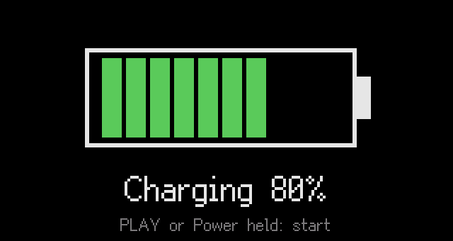
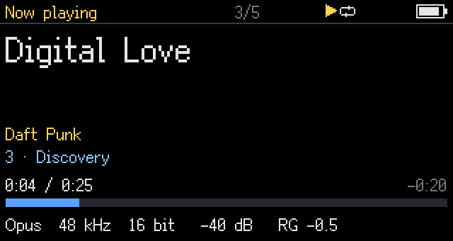
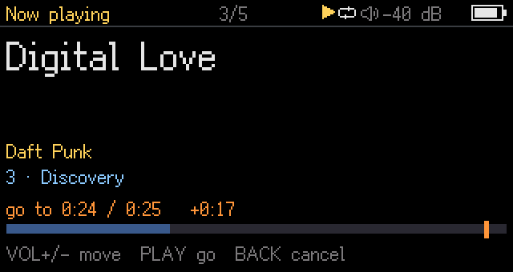
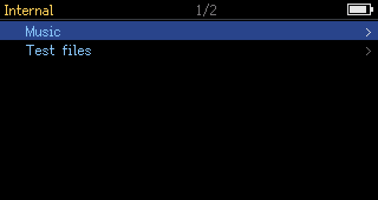
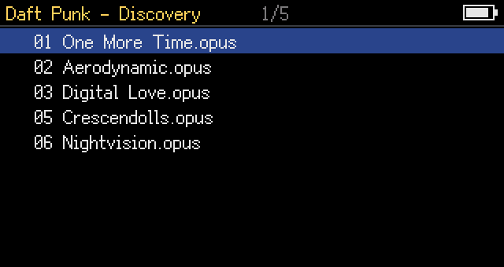
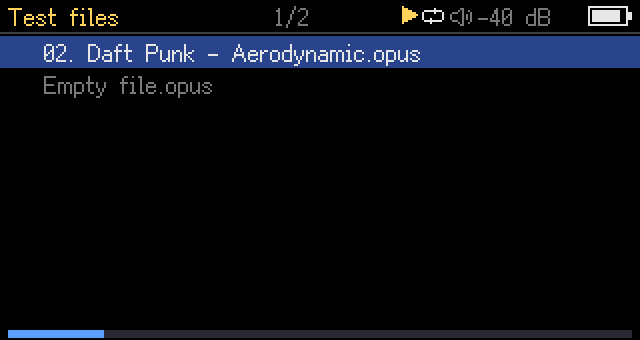
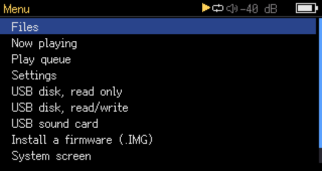
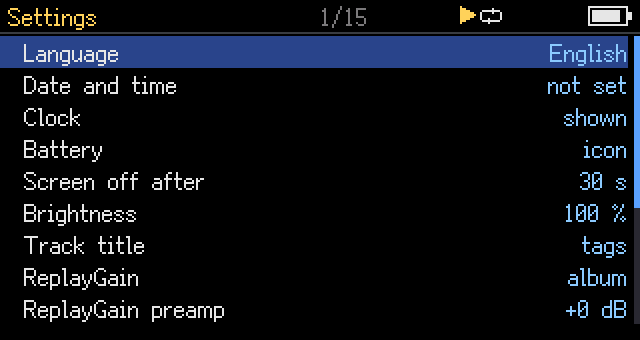
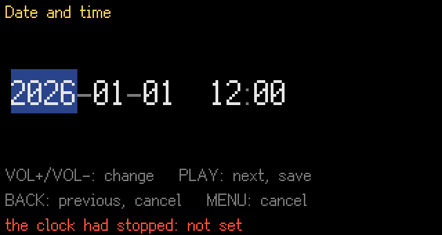
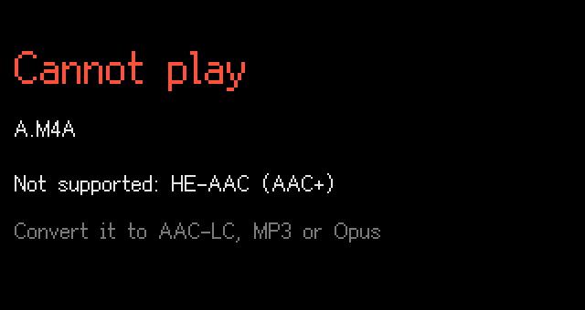

# User manual

This manual is for the ECHO MINI new firmware, version 0.104. It describes what the player shows
and what each key does on each screen. To install the firmware, see "Installing" at the end.

The screenshots come from the emulator of the build tree (`fw/tools/emu_fw.py`), playing a few
tracks of Daft Punk's "Discovery" in Opus. The emulator has no real-time clock, so the clock is
missing from the header and the date screen says it is not set.

## The header

Every screen (browser, play screen, menu, settings, play queue) starts with the same header, a
thin line under it:

- at the left, the screen's title (the folder's name in the browser);
- the position in the list or in the play queue, as "3/5";
- the clock (Settings: "Clock");
- what plays: a play sign, two bars when paused, a square when stopped, nothing when the queue
  is empty;
- the play mode, unless it is "in order": a loop for repeat all, a loop with a 1 for repeat one,
  crossed arrows for shuffle;
- the battery (Settings: "Battery"): an icon, its percent, or the music left ("11h", then
  "45m" under an hour). The level follows the voltage over about a minute, so it does not jump
  when a track starts; on battery it only goes down (a pause lets the voltage rise a little:
  that is not shown), and while charging it stops at 99 % until the charger has finished. With
  the cable in, the battery is blue while charging, and the music left shows the percent
  instead. The battery turns red under 3.425 V.

## The keys

| Key | Where |
|---|---|
| **Power** | the side button that switches the player on |
| **VOL+**, **VOL-** | the two volume keys |
| **PLAY** | play / pause |
| **BACK** | previous / back |
| **MENU** | menu |

Each key knows three gestures:

- a **press**: a short press, counted when the key is released;
- a **long press**: PLAY, BACK and MENU held for 0.6 s;
- a **held** VOL+ or VOL-: repeats from 0.45 s, about ten steps a second.

**VOL+ and VOL- together**, the "chord", opens the seek mode on the play screen. Press and hold
**VOL+ first, then press VOL-** while still holding VOL+, and release both. The other order does
not work: with both keys down, the player only reads VOL-, so starting with VOL- looks like a
plain VOL- press. Starting with VOL+, the player sees VOL+ turn into VOL- without a release,
which is how it recognises the chord.

When the screen is off, the first key only switches it on. It does nothing else, so a key
pressed in a pocket does not change the track or the volume.

## Switching on and off

| Action | Result |
|---|---|
| Power, player off | starts the player; it resumes where it was (folder, track, position, volume, play mode), or as set in Settings, "At power on" |
| Power, short press | switches the screen off or on; the music goes on |
| Power held 2 s | powers off; the position is saved |

The screen goes off by itself after 30 s without a key (Settings: "Screen off after").

**With the USB cable**: plugging the cable into a player that is off shows the **charging
screen**:

It has a battery bar and "Charging NN %", or "Charged 100 %" once the charger has
finished. On the charging screen:

- any key switches the screen on again;
- PLAY held, or Power held 1 s, starts the player;
- unplugging the cable powers it off.

Holding Power 2 s while playing with the cable in also leads to the charging screen.

## The play screen

From top to bottom:

1. **The header** (above): "Now playing", the position in the play queue, what plays, the play
   mode, the battery.
2. **The title**, or the file name when the file has no title tag. It uses two large lines when
   it fits; longer names scroll in full across one large line after a short pause.
3. **The artist and the album**, or the folder when the file has no album tag. The album comes
   after the track's number when the file has one ("3 · Discovery"). They scroll when too long.
4. **The time**, the time left at the right, and **the bar**.
5. **The format line**:
   - the codec, the sample rate and the bit depth;
   - the volume, as an attenuation in dB;
   - the ReplayGain applied, in the "RG" box. The box is on yellow when the gain is the
     track's own (album mode, no album gain in the file).

### Keys on the play screen

| Key | Action |
|---|---|
| **PLAY** | pause / play |
| **PLAY held** | next track. On the last track (play mode "in order"), it stops; PLAY then plays that last track again from its start |
| **BACK** | back to the start of the track; within its first 3 s, the track before (in shuffle: the one heard before). So a double press of BACK goes to the track before |
| **BACK held** | next play mode: in order → repeat all → repeat one → shuffle → in order. Shuffle plays every track of the queue once, in a random order, then another order |
| **VOL+** / **VOL-** | volume up / down, 1 dB a step (held: repeats) |
| **VOL+ held, then VOL-** | seek mode (below) |
| **MENU** | to the folder browser; the music goes on |
| **MENU held** | main menu |

A short press of VOL+ or VOL- changes the volume when the key is released. A chord that
follows it therefore does not move the volume.

### Seek mode

Hold **VOL+, then press VOL-** on the play screen (in that order, see "The keys"). The music goes on, and the screen shows
a target as a mark on the bar, and how far it is from the current position:

| Key | Action |
|---|---|
| **VOL+** / **VOL-** | target 10 s later / earlier |
| **VOL+** / **VOL-** held | faster: 10 s steps, then 30 s after 1.5 s, then 1 min after 4 s |
| **PLAY** or **MENU** | go to the target |
| **BACK** | cancel, the music goes on where it was |
| no key for 2 s | go to the target |

The track is opened again once, at the target, whatever the number of steps. With Ogg files
(Vorbis and Opus), playback starts up to about a second before the target (the start of an Ogg
page), after a short silence: about 0.2 s (Vorbis) or 0.3 s (Opus).

### Pauses

- Unplugging the headphones pauses the music (when no other headphones stay plugged in the
  other output, 3.5 mm or 4.4 mm). Plugging them back does not start it again: press PLAY.
- A pause of 1 min "parks" the track: the DACs and the HiFi core stop to save the battery.
  PLAY starts it again where it was, after a short delay.
- With nothing playing, the player powers off after 10 min without a key, unless the USB cable
  is in (Settings: "Power off when idle").

## The folder browser

The top level lists **Library** (the music by its tags, below), **Internal** (the internal
memory) and **SD card** (the microSD card, when one is inserted). In a folder, the subfolders come first, then the playable files. Names are
sorted in natural order, ignoring case, so "track 2" comes before "track 10". Empty files
(0 bytes) are greyed and never played.

The header shows the entry selected and the number of entries in the folder ("1/5"). A folder
ends with ">". The track playing is marked with a note. Below, an empty file is
greyed. A selected file or folder name that is too long scrolls after a short pause. While a track
plays, the browser shows its progress bar at the bottom.

| Key | Action |
|---|---|
| **VOL+** / **VOL-** | move up / down (held: repeats) |
| **PLAY** on a folder | open it |
| **PLAY held** on a folder | play everything under it, subfolders included, in order (also on "Internal" or "SD card") |
| **PLAY** on a file | play the folder from this file, and go to the play screen |
| **BACK** | up one folder |
| **MENU** | to the play screen |
| **MENU held** | main menu |

PLAY held takes the whole tree, up to 4,000 folders with tracks and 8 levels of folders (a
folder of more than about 550 tracks is cut). After a power off, the player resumes a track
played from a folder (PLAY on a file), not a queue made by PLAY held.

## The library

**Library**, the first line of the top level, browses the music by its tags rather than by
its folders. It reads the library's index (Settings, Library: built there, and at once after a
USB session in which the computer wrote); with no index yet, it says so.

| List | What it shows |
|---|---|
| Artists | the album artists (the artist when an album has none), then their albums (with their year), then the tracks |
| Albums | all the albums, "album - artist", then the tracks |
| Years | the years of the albums ("Unknown year" last), then their albums, then the tracks |
| Genres | the genres, then their albums, then the tracks |
| All songs | every track by its title, "title - artist" |

The keys are those of the folder browser: VOL+ / VOL- move, PLAY opens, BACK goes up, MENU to
the play screen and back. **PLAY on a track** plays the list it is in (the album, or all the
songs) from that track. **PLAY held** on any other line plays all its tracks: an album, an
artist (all their albums), a year, a genre (the albums of that genre), or a line of the top of
the library (Artists, Albums, Years and Genres: the whole library in that order; All songs: by
title); in order, or anywhere in it when shuffle is on. After a power off, the player resumes
the track, and the browser shows the library's list again.

- The tracks of the microSD card show only when the card the library was built with is in.
  When another card is in (or the library was made without one), the first line says **SD card
  not in the library: PLAY to update**; a card that cannot be read (FAT16, a damaged one): **SD
  card not readable**. An update made without the library's card (taken out, or another one
  that cannot be read) keeps its tracks as they are: when it is back, they show again at once.
  The library knows one card: an update made with another card that can be read replaces the
  first card's tracks by the new card's (the first card back, its tracks are read again).
- The last line, **Update the library**, does what Settings, Library does: the files are
  counted, and nothing is read or written when none changed (3 s); files changed meanwhile,
  on the internal memory or on the card (copied with a card reader), are read again.
- A track on both the internal memory and the card (the same album, disc, number and title) is
  shown once: the internal memory's.
- Names sort without regard to case and accents, "The" left out of the artists.

## The play queue

What plays is kept on the internal memory, in NEWFWQ.DAT (made by the player, 3 MiB): after a
power off it resumes at once, and tracks can be added while the music plays.

**The queue mode**: in the folder browser or the library, press **VOL+ and VOL- together**. The
title shows "Queue: PLAY next, MENU add".

| Key | Action |
|---|---|
| **PLAY** | the line goes next: right after the track playing (in shuffle too) |
| **MENU** | the line goes at the end of the queue |
| **PLAY held** on a folder or a list | opens it (the mode stays) |
| **BACK** | leaves the queue mode |

A line is a track, a folder (its files), or a list of the library (an album, an artist...). The
title says what was done ("Next: 12 tracks"). With nothing queued, the line plays at once.

**The queue's screen**: main menu, **Play queue**. The tracks in the queue's order, the one
playing marked; PLAY plays the one chosen. Its first line, **Empty the queue**, keeps only the
track playing; **PLAY held** on any line does the same (a long queue: the first line is far up).

Tracks of the microSD card are passed over while the card is out, or while another card is in
(the queue goes on with the others): a track is never looked for on a card it is not on. A queue holds up to 24,576 tracks.

## The main menu (MENU held)

VOL+ / VOL- move, PLAY chooses, BACK or MENU closes the menu. The music goes on while the menu
is open, except for the USB and system entries, which stop it.

| Entry | What it does |
|---|---|
| Files | the folder browser |
| Now playing | the play screen |
| Play queue | the play queue: its tracks, PLAY plays one, the first line empties it |
| Settings | the settings screen (below) |
| USB disk, read only | the internal memory as a USB disk; the computer can read it but not write to it |
| USB disk, read/write | the same, and the computer can write to it (copy music, firmware images) |
| USB sound card | the player as a USB sound card for a computer (see below) |
| Install a firmware (.IMG) | the installer (see "Installing") |
| System screen | hardware state (battery, keys, plugs, clocks); any key returns |
| USB loader mode (exit: RST) | restarts into the loader's USB mode, for recovery from a computer; leave it with the RST hole |

**USB disk**: plug the cable, then choose the entry.
- Leave with **BACK**, after ejecting the disk on the computer.
- After a read/write session, the clock is set from the newest file the computer wrote, when
  the clock was not set or was behind that file.
- The microSD card is not available over USB yet.
- When the computer wrote, the library is updated at once (see Settings, Library).

**USB sound card** (0.97, high speed in 0.98, 192 kHz in 0.99, remote and Power key since 0.99): plug the cable, then choose the entry. The computer
sees a sound card named "ECHO MINI" (USB Audio Class 2 at high speed, or Class 1 on an older
full-speed port; asynchronous, no driver needed), and its sound comes out of the player's
headphone outputs, sample for sample: the player keeps its own clock and tells the computer how
many samples to send ("feedback" on the screen).
- Formats: 16, 24 or 32 bits, 44.1, 48, 88.2, 96, 176.4 or 192 kHz, stereo (full speed: 16 or 24
  bits, 44.1 or 48 kHz). Other rates are converted by the computer.
- **VOL+** / **VOL-** set the sound card's own volume, kept for the next time (the first time,
  the playback volume); the computer's volume (and mute) adds to it, in 0.5 dB steps on the
  DACs.
- **The remote** (high speed only): the player also acts as a headset remote for the computer's
  player, like the buttons of a wired or Bluetooth headset:

  | Key | Effect on the computer |
  |---|---|
  | PLAY | play / pause |
  | VOL+ pressed twice | next track |
  | VOL- pressed twice | previous track |
  | MENU | turns the remote on or off (kept for the next time; on at first) |

  A single press of VOL+ or VOL- (or a held key) still sets the volume; on a double press the
  volume step of the first press is undone. With the remote off, the computer receives no key.
  Tested with VLC and a browser (YouTube) on Linux; the computer's player must follow the media
  keys.
- **Power**: a short press switches the screen off or on, the sound goes on; held 2 s, it leaves
  the sound card and powers off (the charging screen, the cable being in).
- Leave with **BACK held**, or by unplugging the cable.
- The screen shows the state (waiting for the computer, connected, playing), the format and the
  rate asked of the computer, both volumes, and counters: the fill of the output buffer (about
  10 ms), the samples dropped or repeated (0: they are only a fallback, should the computer not
  follow), and the packets missed (a few when a stream starts).
- Tested with Linux (bit-perfect), an Android phone (Pixel 6a) and an iPhone. The phones ignore
  the player's clock: the player then drops a sample now and then, about two a second, evenly
  (inaudible, but not bit-perfect). On an iPhone with sound on one side only, check its Balance
  setting (Accessibility, Audio & Visual). Windows and macOS are not tested yet.

### Settings

| Key | Action |
|---|---|
| **VOL+** / **VOL-** | move up / down |
| **PLAY** | next value (after the last one, back to the first) |
| **PLAY held** | previous value |
| **BACK** or **MENU** | close the screen; the settings are saved |

Each change takes effect at once. The settings are kept with the resume state and survive a
power off (except the sleep timer).

| Setting | Values | Default |
|---|---|---|
| Language | the language of the screens: English, Français, 日本語, 简体中文 (the catalogues of the image; see below). This line stays in English, so that it can be found in any language | English |
| Date and time | shows the date and time; PLAY opens the clock screen (below) | |
| Clock | **shown**: the time at the top of the play screen and the browser (once the clock is set); **hidden**: not shown | shown |
| Battery | what the header shows of the battery: **icon**; **percent**; **time left**, the music left with the screen off, from full runs on battery (about 14.5 h), less 10 % for the screen and the keys: it is meant to be short of the real time rather than over it | icon |
| Screen off after | 10 s, 30 s, 1 min, 2 min, 5 min, never | 30 s |
| Brightness | 10 steps: 8, 12, 17, 23, 30, 39, 50, 63, 80, 100 % (even steps to the eye) | 100 % |
| Track title | **tags**: the title, artist and album tags; **file name**: the file name and the folder | tags |
| ReplayGain | **album**: the album gain, or the track gain when the file has no album gain; **track**: the track gain; **auto**: album, but track in shuffle; **off**: no gain. Limited by the peak tag, so that a track never clips | album |
| ReplayGain preamp | -6 dB to +6 dB, added to the gain of tagged tracks (still limited by the peak) | 0 dB |
| At power on | **resume playing**: opens the play screen and resumes the track; **resume paused**: opens the play screen with the track paused, PLAY starts it; **browser**: only the folder is shown | resume playing |
| Sleep timer | off, 15, 30, 45, 60, 90 min; shows the minutes left. At the end the music fades out over 5 s, pauses, and the player powers off (it resumes paused there) | off |
| Power off when idle | 5, 10, 20, 30 min, never: nothing played and no key for that long (not with the USB cable) | 10 min |
| Swap VOL+ and VOL- | the volume keys of the play screen swapped (lists and seek unchanged) | no |
| Library (PLAY: update) | the tracks in the library's index, or **none**; PLAY updates it (below) | |
| Restore the defaults | PLAY puts back all the defaults above, except the language | |

**Library** (browsed from the top level, above): an index of the tags of the
music on the internal memory and the card, in the file NEWFWLIB.DAT at the root of the internal
memory (created by the player, 8 MiB). The update stops the music and shows its progress:
looking for the music, reading the tags, sorting, writing. Files not changed since the last
update are not read again, and an update with the same files ends in a few seconds. **BACK**
stops it; the library before is kept, as after a power cut. Reading the tags is the long part:
about 3 to 4 minutes for 18,000 tracks the first time. Big cover art embedded in the files
slows it down (an Ogg or Opus file is read through its whole cover): 600 pixels wide are
plenty for the player's screen.

The translations are those of `fw/po/` in the repository (docs/TRANSLATING.md): a string not yet
translated shows in English. The Japanese and Simplified Chinese ones are partial for now. The log
(NEWFWLOG.TXT), the system screen and the fault screen stay in English.

### Date and time

Settings, second line, PLAY.

| Key | Action |
|---|---|
| **VOL+** / **VOL-** | change the highlighted field |
| **PLAY** | next field; on the last one (minutes), save |
| **BACK** | previous field; on the first one (year), cancel |
| **MENU** | cancel |

The clock keeps local time. There is no automatic summer / winter time change: set it again by
hand.

## Messages

| Message | Meaning |
|---|---|
| **Cannot play**: name, what went wrong, what to do | the track chosen could not be played, nor the next ones of the queue. What went wrong: an empty file; a damaged file (or not what its name says); a variant of a format the player does not play, with the reason (more than 2 channels, floating-point or compressed WAV/AIFF, HE-AAC, another AAC profile, multichannel Opus, a bit depth, too large for the memory); a read error; an internal error (please report it with `NEWFWLOG.TXT`). Shown 3 s, then the browser; the log has the same line, `error:` |
| **Low battery** / plug the USB cable | under 3.425 V (about 45 minutes of playback left). With music, three beeps, then one every 5 min |
| **Battery empty** | under 3.3 V for 30 s. Two low beeps, a pause, then the player powers off; the position is saved. Under 3.35 V the player does not start |
| **SD card (not readable)** | the card could not be read; take it out and insert it again |
| **Fault**: the last session ended on a fault | shown 3 s at the start after the player stopped on a fault or froze (the watchdog restarted it). The details are in `NEWFWLOG.TXT` (`crash:` lines); please report them. A fault of the HiFi core while playing is handled without a restart: the track starts again 1 s before, or is skipped if it happens twice |

A damaged file (5 s with no audio while it reads on) is skipped, and the queue goes on with
the next one.

## Formats

| Format | Extensions | Notes |
|---|---|---|
| WAV | `.wav` | PCM, 8 to 32 bits; RIFF INFO or ID3v2 tags |
| AIFF | `.aif`, `.aiff`, `.aifc` | PCM, 8 to 32 bits (AIFF-C: uncompressed only); ID3v2 tags (ReplayGain too), else NAME / AUTH |
| FLAC | `.flac` | |
| MP3 | `.mp3` | ID3v2 tags, ReplayGain from ID3v2 |
| Ogg Vorbis | `.ogg` | not played: floor 0 (encoders before 2001) and blocks over 4096 samples (no current encoder makes them) |
| Opus | `.opus` | R128 gain tags |
| AAC | `.m4a`, `.m4b`, `.mp4` | AAC-LC, mono or stereo; iTunes tags and ReplayGain; gapless |
| ALAC | `.m4a`, `.m4b`, `.mp4` | Apple Lossless, 16, 20 or 24 bits, mono or stereo; iTunes tags and ReplayGain |
| Musepack | `.mpc`, `.mp+`, `.mpp` | SV7 and SV8; APEv2 tags and ReplayGain; gapless |

Sample rates from 8 to 192 kHz: 8, 11.025, 12, 16, 22.05, 24, 32, 44.1, 48, 64, 88.2, 96, 128,
176.4 and 192 kHz, played as they are; any other rate is upsampled on the HiFi core. Tracks play gapless: the next track is queued behind the
end of the current one.

Not supported yet: HE-AAC, AAC in `.aac` files; floating-point WAV and AIFF. Files of 4 GiB or more are not
listed.

Storage:
- the internal memory (FAT32);
- a microSD card in FAT32 or exFAT, which can be inserted or taken out while the player runs.

## Installing

1. Copy the image (`NEWFW104.IMG` from the release, or `HIFIEC70.IMG` from the build renamed for
   instance `NEWFW104.IMG`) to the
   root of the internal memory. Use the stock firmware's USB disk, or "USB disk, read/write"
   with this firmware.
2. Main menu → **Install a firmware (.IMG)**:
   - VOL+ / VOL- choose the image (long names are shown, and scroll when too long), and PLAY
     checks it;
   - PLAY then installs it, and BACK cancels.
3. Do not power off during the install. The battery must be above 3.6 V, or the USB cable in.
4. The player restarts on the new firmware.

**The settings and the resume state** are kept in `NEWFWLOG.TXT`, at the root of the internal
memory, with the log; the firmware never creates files, so without it nothing is kept after a
power off. Create it once from the computer: `python3 fw/tools/mklog.py /path/to/the/player`
(1 MiB, in one piece; `--force` replaces an existing one, and so loses the settings and the
resume state).

**Keep a stock image** at the root of the internal memory, under a name that neither firmware
installs by itself, for instance `STOCK39.IMG`. Avoid `HIFIECnn.IMG` and `ECHOMINI.IMG`. To go
back to the stock firmware, install that image the same way.

**Recovery**, when the player no longer starts: hold VOL- while plugging the USB cable into the
switched-off player. This enters the loader's USB mode, from which a computer can write an image
(see `fw/README.md`).
